## operaciones basicas con open cv
## Alumno Axel Guzman 0070
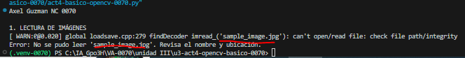
## 1. LECTURA DE LA IMAGEN DESDE LA CARPETA
# cuando no puede cargar la imagen

# cuando puede leer la imagen
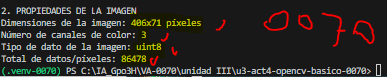
# 2. PROPIEDADES DE LA IMAGEN

## Mostrando imagen original

# nueva terminal

# 4. ACCESO Y MODIFICACION DE PIXELES INDIVIDUALES
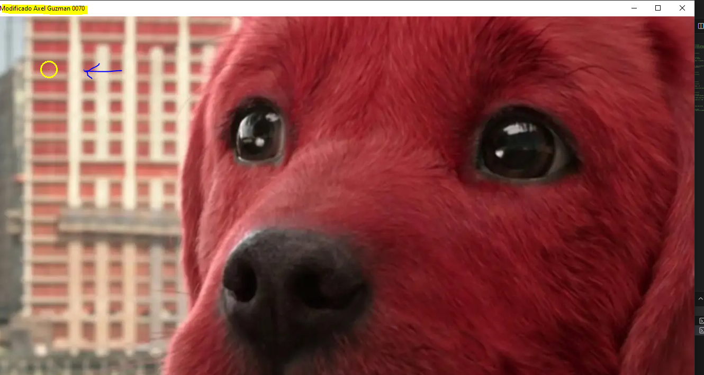

# 5. REGIÓN DE INTERÉS (ROI - REGION OF INTEREST)
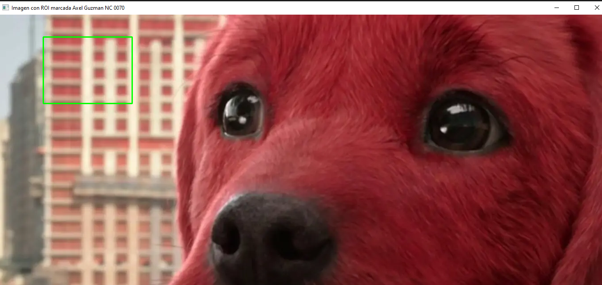

# 6. SEPARACIÓN Y FUSIÓN DE CANALES DE COLOR (BGR)
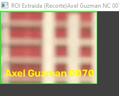

# 7. REDIMENSIONAMIENTO DE IMÁGENES (RESIZING)
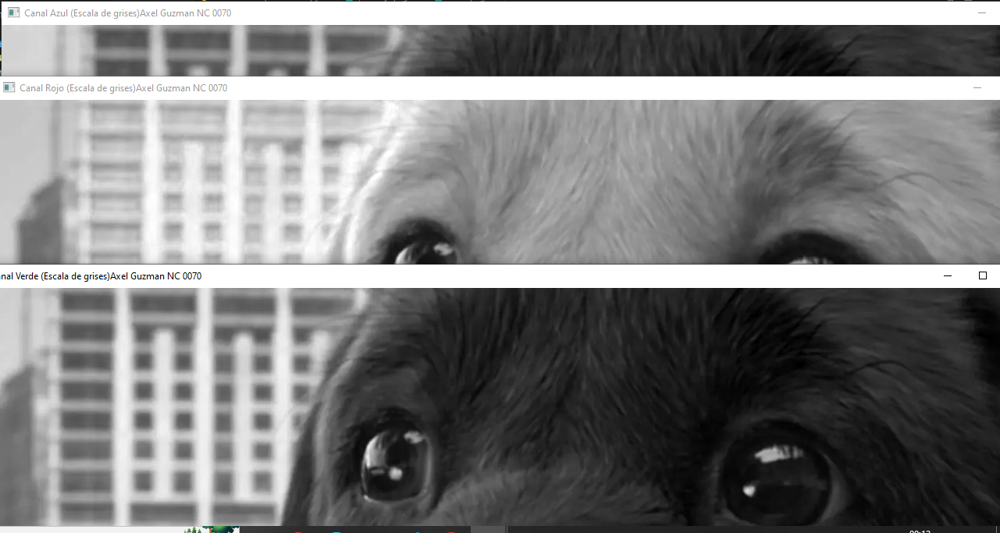

# 8. ROTACIÓN DE IMÁGENES
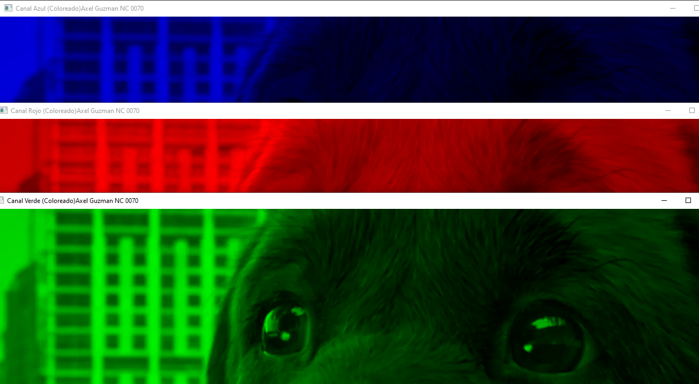

# 9. VOLTEO / ESPEJO DE IMÁGENES (FLIPPING)
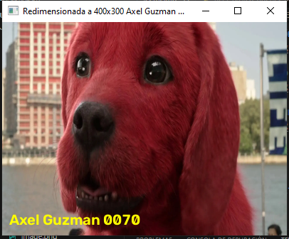

# 10. GUARDADO DE RESULTADOS Y LIMPIEZA
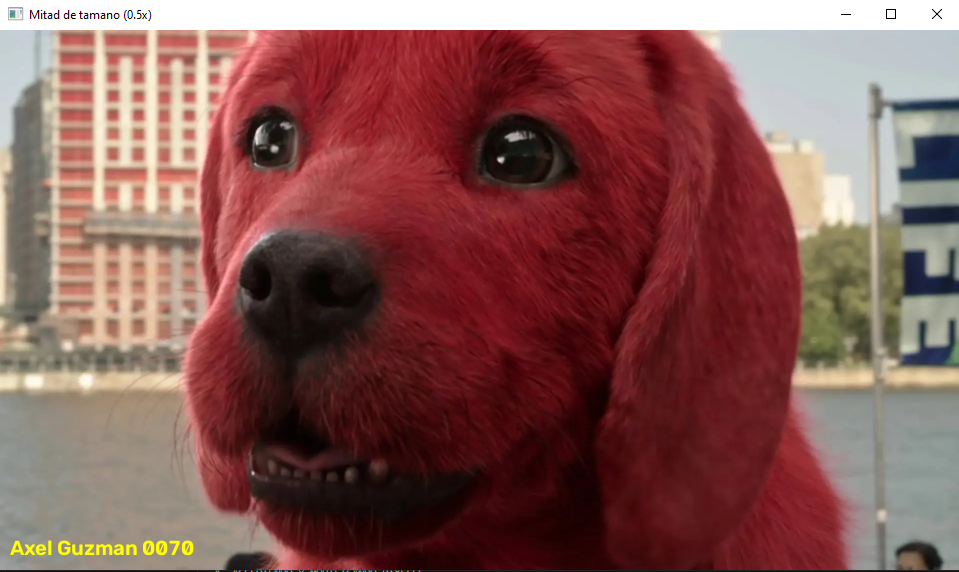
# 11. ampliada
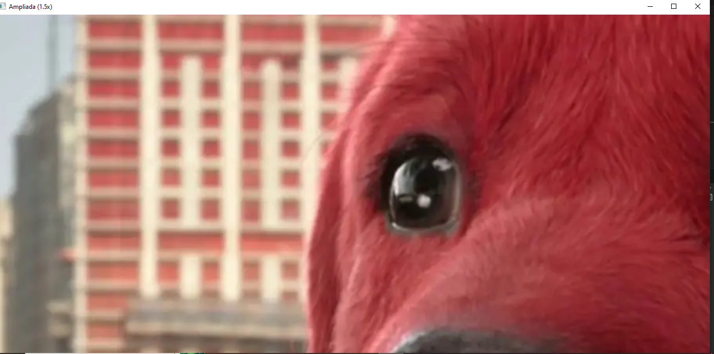
# 12. girada 45 grados
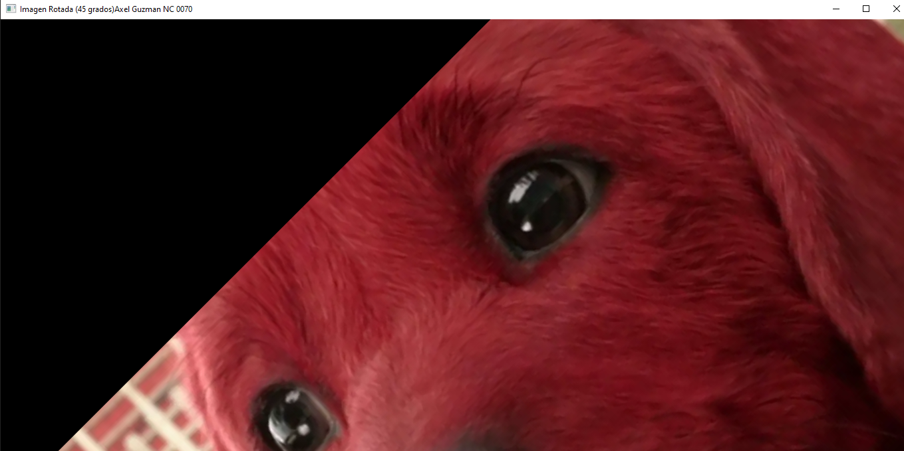
# 13. modo espejo
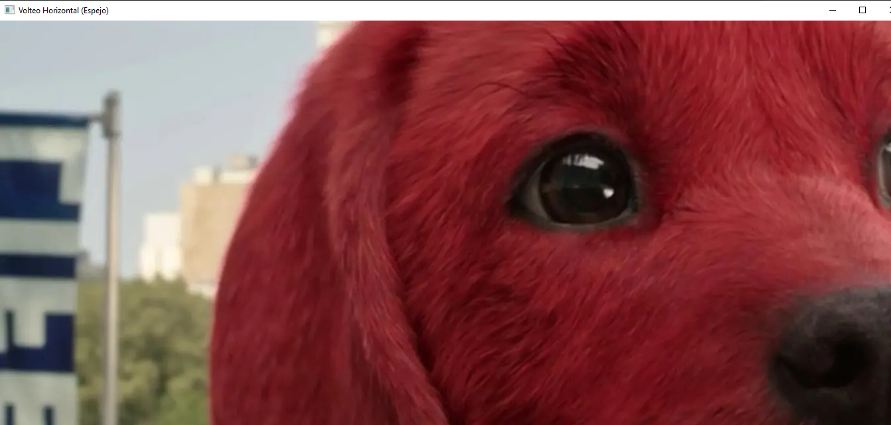
# 14. al revez
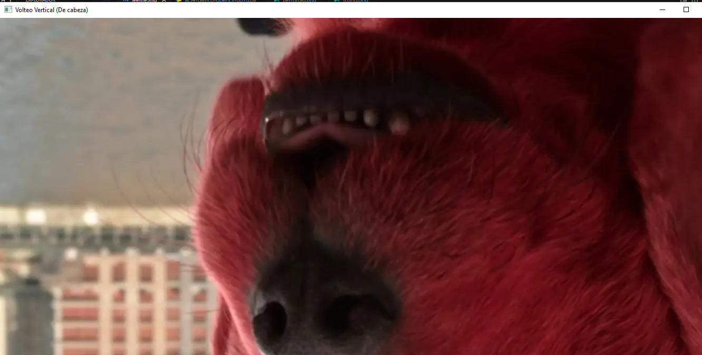
# 15. modo espejo al revez
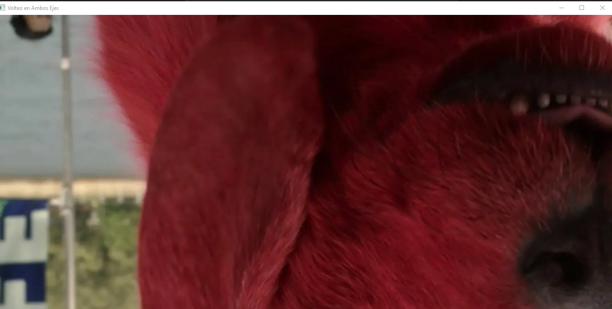