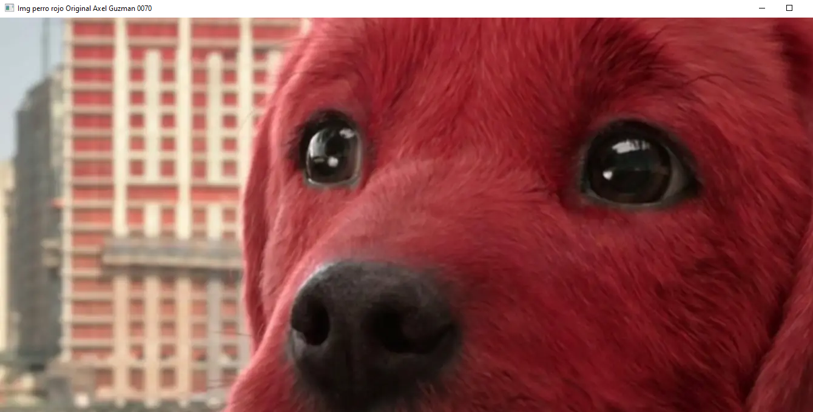
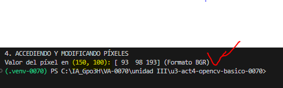

## operaciones basicas con open cv
## Alumno Axel Guzman 0070

## 1. LECTURA DE LA IMAGEN DESDE LA CARPETA
# cuando no puede cargar la imagen

# cuando puede leer la imagen

# 2. PROPIEDADES DE LA IMAGEN

## Mostrando imagen original

# nueva terminal

# 4. ACCESO Y MODIFICACION DE PIXELES INDIVIDUALES
