## operaciones basicas con open cv
## Alumno Axel Guzman 0070

## 1. LECTURA DE LA IMAGEN DESDE LA CARPETA
# cuando no puede cargar la imagen

# cuando puede leer la imagen

# 2. PROPIEDADES DE LA IMAGEN

## Mostrando imagen original
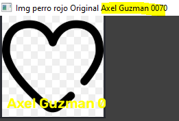

# nueva terminal

# 4. ACCESO Y MODIFICACION DE PIXELES INDIVIDUALES
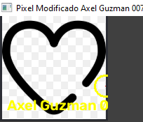
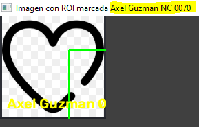
# 5. REGIÓN DE INTERÉS (ROI - REGION OF INTEREST)
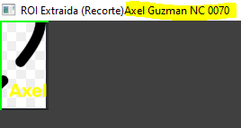
# 6. SEPARACIÓN Y FUSIÓN DE CANALES DE COLOR (BGR)
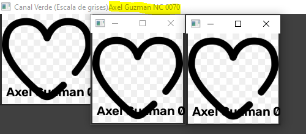
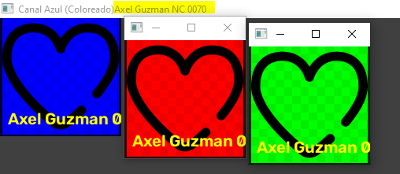
# 7. REDIMENSIONAMIENTO DE IMÁGENES (RESIZING)
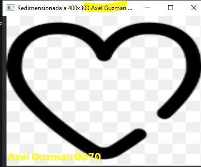
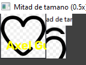
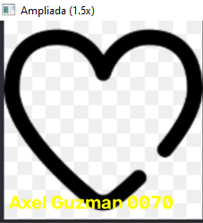
# 8. ROTACIÓN DE IMÁGENES
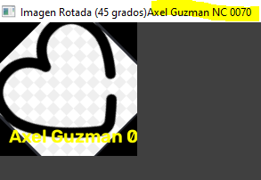

# 9. VOLTEO / ESPEJO DE IMÁGENES (FLIPPING)
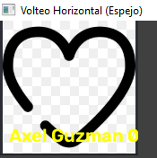
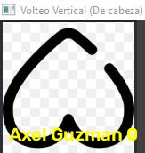

# 10. GUARDADO DE RESULTADOS Y LIMPIEZA
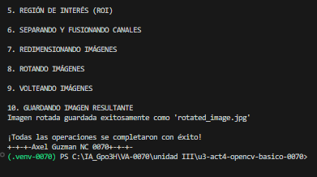